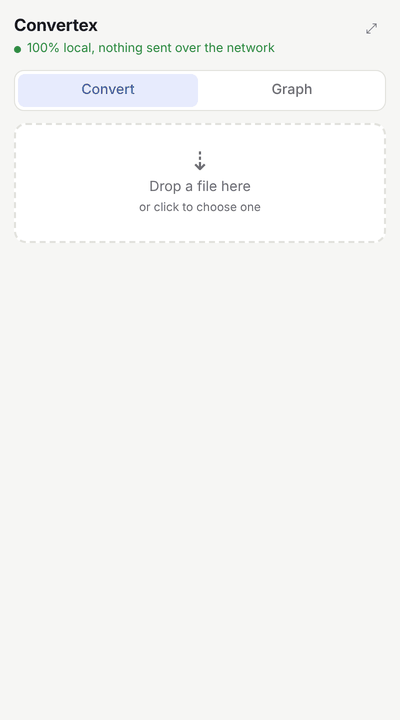
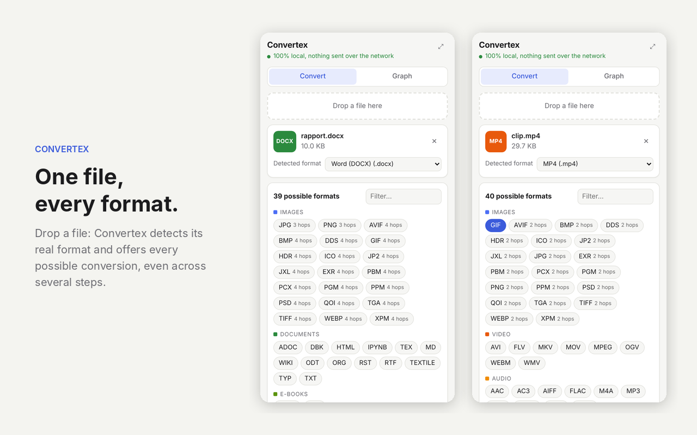
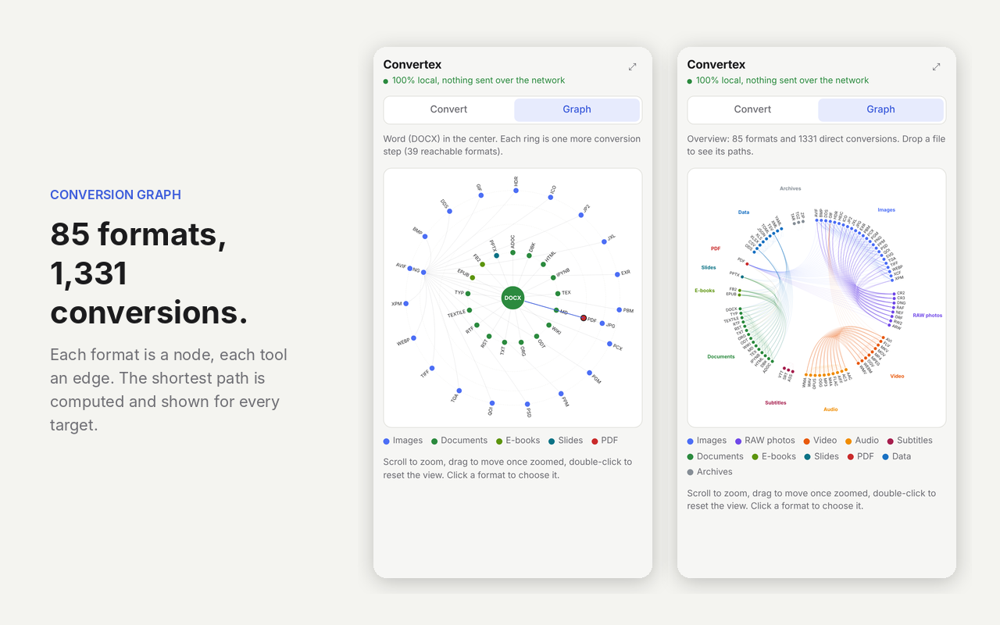

# Convertex

[](https://chromewebstore.google.com/detail/eemhkdhchanmcoejnmfpgilajfngdjad?utm_source=github)
[](https://chromewebstore.google.com/detail/eemhkdhchanmcoejnmfpgilajfngdjad?utm_source=github)
[](LICENSE)

**English** | [Français](README.fr.md)

**[Install Convertex from the Chrome Web Store](https://chromewebstore.google.com/detail/eemhkdhchanmcoejnmfpgilajfngdjad?utm_source=github)**

<p align="center"></p>

Convertex (convert + vertex, a node of a graph) is a Chrome extension that converts a file to every format it can reach among 85, right inside the browser. No file ever leaves the computer: no server, no API, everything runs in WebAssembly.

## Screenshots

<p align="center">
  
  
</p>

## How it works

You drop a file into the side panel. The extension detects its real format (binary signature, contents of ZIP containers, then extension), lists every reachable format and converts in one click.

The core of the project is a **conversion graph**:

- each format is a node (85 in total);
- each engine adds weighted edges (1,331 direct conversions);
- Dijkstra's algorithm finds the cheapest path to every target, up to 4 steps. For example `DOCX → Markdown → PDF → PNG`.

The search runs over states (format, information lost so far) to rule out absurd paths: an image wrapped in a PDF cannot come back out as text, and a photo turned into a GIF does not become a one-frame "video".

When a step produces several files (a 10-page PDF gives 10 images), the following steps apply to each of them and the result is bundled into a ZIP.

The **Graph** tab draws these paths: the source format in the center, one ring per extra step, and the chosen path highlighted. Without a file, it shows the full map of formats and their links.

## Formats

| Family | Formats |
|---|---|
| Images | PNG, JPG, WEBP, GIF, BMP, TIFF, ICO, AVIF, JPEG XL, JPEG 2000, QOI, TGA, PSD, PCX, PPM, PGM, PBM, XPM, DDS, EXR, HDR, plus HEIC, XCF and SVG as input |
| RAW photos (input) | CR2, CR3, NEF, ARW, DNG, ORF, RW2, RAF |
| Video | MP4, WEBM, MKV, AVI, MOV, FLV, WMV, MPEG, OGV, animated GIF |
| Audio | MP3, WAV, OGG, FLAC, AAC, M4A, OPUS, WMA, AIFF, AC3 |
| Subtitles | SRT, VTT, ASS |
| Documents | DOCX, ODT, RTF, HTML, Markdown, TXT, LaTeX, Typst, RST, Org, AsciiDoc, MediaWiki, Textile, DocBook, Jupyter |
| Books and slides | EPUB, FB2, PPTX |
| PDF | creation from images or documents, text extraction, pages rendered as images |
| Data | CSV, TSV, JSON, YAML, TOML, XML, XLSX, XLS, ODS |
| Archives | ZIP, TAR, TAR.GZ |

## Engines

| Engine | Role | Runs in |
|---|---|---|
| [ffmpeg.wasm](https://github.com/ffmpegwasm/ffmpeg.wasm) | audio, video, subtitles | worker |
| [Pandoc](https://github.com/pandoc/pandoc-wasm) | documents, books, slides | worker |
| [ImageMagick](https://github.com/dlemstra/magick-wasm) | images and RAW photos | worker |
| [pdf.js](https://github.com/mozilla/pdf.js) | reading and rendering PDFs | panel |
| [pdf-lib](https://github.com/Hopding/pdf-lib) | writing PDFs (DejaVu font for Unicode) | panel |
| [SheetJS](https://sheetjs.com) | spreadsheets | panel |
| js-yaml, smol-toml, fast-xml-parser | structured data | panel |
| [fflate](https://github.com/101arrowz/fflate) | archives (TAR written by hand) | panel |

The three heavy engines are only loaded the first time they are needed, inside a Web Worker, so the interface stays responsive.

The interface is shown in French when the browser is in French, in English otherwise.

## Privacy

Convertex does not collect, store or transmit any data. Files are processed only inside the user's browser.

The manifest's security policy contains `connect-src 'self'`: Chrome blocks any request to a domain other than the extension itself. The extension asks for no access to websites. All engines and fonts are bundled, nothing is downloaded from a CDN.

## Install

The easiest way is the [Chrome Web Store](https://chromewebstore.google.com/detail/eemhkdhchanmcoejnmfpgilajfngdjad?utm_source=github).

To build it from source:

```bash
npm install
npm run build
```

Then in Chrome: open `chrome://extensions`, turn on **Developer mode**, click **Load unpacked** and pick the `ext/` folder.

## Structure

```
src/
  formats.js         registry of the 85 formats
  detect.js          detection of a file's real format
  graph.js           graph edges and Dijkstra
  pipeline.js        runs a path, step by step
  worker.js          ffmpeg, Pandoc and ImageMagick
  engines-main.js    spreadsheets, data, archives, PDF writing
  engines-browser.js pdf.js and Canvas
  graphview.js       SVG drawing of the graph (zoom, pan)
  ui.js              side panel
  i18n.js            interface strings in English and French
ext/                 extension ready to load (after the build)
build.mjs            esbuild bundle and engine copy
```

## Limitations

- A PDF produced from a document uses a simple layout (headings, paragraphs, lists, tables, code): no images or advanced formatting.
- No text recognition (OCR): a scanned PDF cannot become text.
- Very large files (multi-GB videos) are limited by the browser's memory.
- Proprietary formats without a free library (DWG, INDD…) are not supported.

## Development

This project was built with [Claude Code](https://claude.com/claude-code).

## License

GPL-3.0 or later, because ffmpeg (with x264) and Pandoc are GPL. DejaVu fonts under their own free license (see `assets/fonts`).
